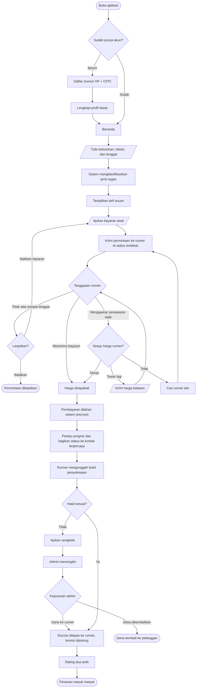
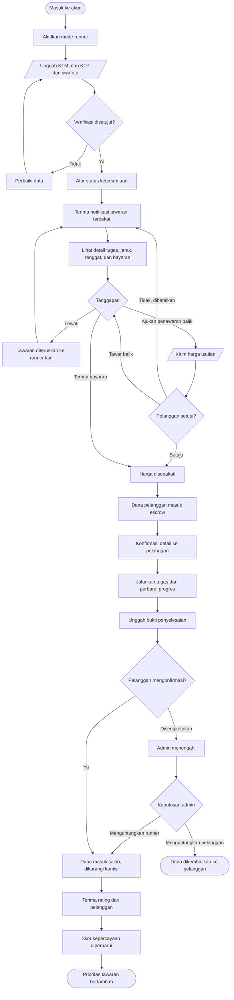
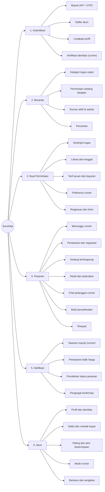

# SuruhAja — User Flow & Information Architecture

Dokumen kerja untuk diskusi tim sebelum pembuatan prototipe.
Aplikasi jasa suruh berbasis AI yang mempertemukan kebutuhan harian dengan runner terverifikasi di sekitar pengguna.

**Status:** draf — menunggu ACC tim
**Mata kuliah:** Kewirausahaan Berbasis Teknologi — Departemen Sistem Informasi ITS
**Tim:** Annisa Nur Fauzi · Lailatul Fitaliqoh · Harbima Razan Adhitya · Rahmadhona Elokpribadi K

---

## Keputusan yang sudah diambil

| Topik       | Keputusan                                                                                                                                              | Acuan              |
| ----------- | ------------------------------------------------------------------------------------------------------------------------------------------------------ | ------------------ |
| Skema harga | Sistem memberi **tarif acuan**, pelanggan mengajukan bayaran awal, runner dapat **mengajukan penawaran balik** hingga tercapai kesepakatan | Laporan subbab 3.1 |
| Pembayaran  | Ditahan sistem (*escrow*) setelah harga disepakati, dilepas setelah pelanggan mengonfirmasi                                                          | Laporan subbab 3.2 |
| Verifikasi  | Wajib untuk runner sebelum dapat menerima tugas                                                                                                        | Laporan subbab 3.2 |

> **Catatan untuk revisi laporan.** Subbab 3.2 saat ini masih menyatakan "harga tidak lagi dinegosiasikan secara personal". Kalimat itu bertentangan dengan skema 3.1 yang kita pakai, jadi perlu diselaraskan. Framing yang bisa dipakai: negosiasi tetap ada, tetapi berlangsung **di dalam sistem dengan harga acuan sebagai jangkar**, bukan tawar-menawar personal lewat chat pribadi. Rasa sungkan runner berkurang karena ada angka acuan yang netral, bukan karena negosiasinya dihapus.

---

## 1. User Flow — Sisi Pelanggan

---

## 2. User Flow — Sisi Runner

---

## 3. Information Architecture

**Navigasi bawah:** Beranda · Pesanan · ➕ Buat Permintaan · Notifikasi · Akun

---

## 4. Daftar layar untuk prototipe

Versi lengkap IA berisi sekitar 28 layar. Untuk prototipe *clickable* yang hanya perlu menunjukkan jalur utama, 12 layar berikut sudah memadai.

| No | Layar                        | Sisi      | Catatan                                          |
| -- | ---------------------------- | --------- | ------------------------------------------------ |
| 1  | Masuk / Daftar               | Keduanya  | Cukup satu layar dengan OTP palsu                |
| 2  | Beranda                      | Pelanggan | Kategori tugas + pesanan berjalan                |
| 3  | Buat Permintaan              | Pelanggan | Deskripsi, lokasi, tenggat                       |
| 4  | Tarif acuan & bayaran        | Pelanggan | Layar kunci — tunjukkan angka acuan dari sistem |
| 5  | Menunggu runner              | Pelanggan | Status pencarian                                 |
| 6  | Penawaran balik masuk        | Pelanggan | Layar kunci — tunjukkan alur negosiasi          |
| 7  | Daftar tawaran               | Runner    | Detail tugas, jarak, bayaran                     |
| 8  | Ajukan penawaran balik       | Runner    | Layar kunci — sisi lain dari negosiasi          |
| 9  | Pesanan berjalan & pelacakan | Keduanya  | Peta + status                                    |
| 10 | Unggah bukti penyelesaian    | Runner    |                                                  |
| 11 | Konfirmasi & rating          | Pelanggan |                                                  |
| 12 | Akun & skor kepercayaan      | Runner    | Tunjukkan rekam jejak                            |

Layar sengketa, riwayat, dan verifikasi identitas cukup ditampilkan sebagai gambar statis di laporan, tidak perlu dibuat *clickable*.

---

## 5. Yang perlu di-ACC tim

- [ ] Alur negosiasi: berapa kali maksimal tawar-menawar sebelum permintaan ditutup?
- [ ] Batas waktu menunggu runner sebelum pelanggan diminta menaikkan bayaran
- [ ] Apakah penawaran balik dikirim oleh satu runner saja, atau beberapa runner bersaing sekaligus?
- [ ] Besaran komisi platform dan biaya layanan (masih asumsi di laporan)
- [ ] Revisi kalimat subbab 3.2 agar selaras dengan skema harga 3.1

Setelah poin-poin ini disepakati, prototipe bisa langsung dikerjakan.
