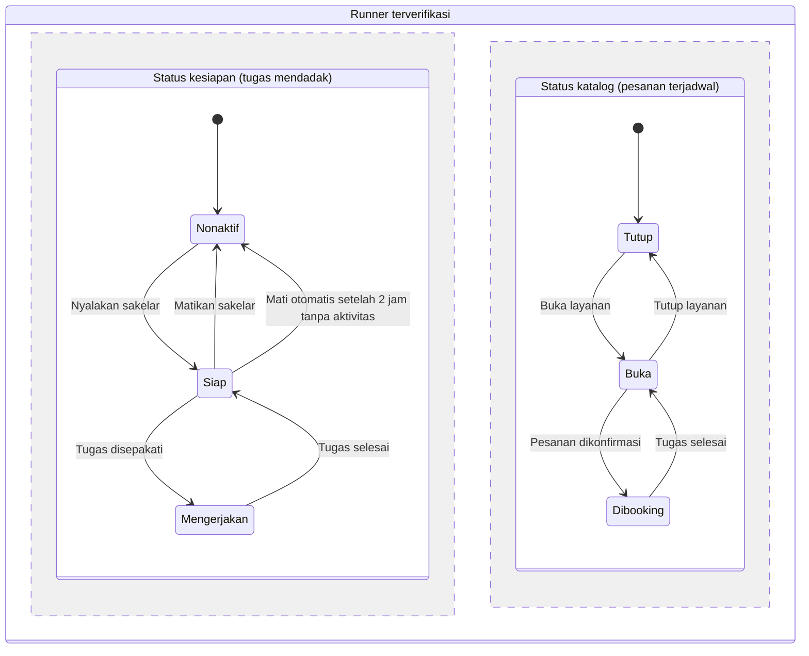

# Konsep dan Aturan Main

Pembaruan terakhir: 24 Oktober 2026

---

## Dua jalur masuk, satu alur penyelesaian

|               | Jalur A — Permintaan                     | Jalur B — Katalog                                               |
| ------------- | ----------------------------------------- | ---------------------------------------------------------------- |
| Siapa memulai | Pelanggan menulis kebutuhan               | Runner memasang jasa lebih dulu                                  |
| Harga         | Tarif acuan sistem, lalu bisa dinegosiasi | Tetap, sesuai yang dipasang runner                               |
| Cocok untuk   | Tugas mendadak dan tidak baku             | Jasa dengan spesialisasi, misalnya survei kos atau bersih-bersih |
| Negosiasi     | Ya, maksimal 3 putaran                    | Tidak ada                                                        |

Begitu harga disepakati, sisanya identik untuk kedua jalur: escrow, pengerjaan, bukti penyelesaian, konfirmasi, pencairan dana, rating. Yang bertambah hanya pintu masuknya, bukan keseluruhan sistem.

Runner **tidak perlu memilih** tipe saat mendaftar. Siapa pun boleh memasang katalog sekaligus menerima permintaan acak, selama waktunya masih kosong.

---

## Parameter operasional

| Parameter                    | Nilai                                                                | Status           |
| ---------------------------- | -------------------------------------------------------------------- | ---------------- |
| Harga awal                   | Sistem memberi tarif acuan setelah mengklasifikasikan tugas          | Disepakati       |
| Maksimal negosiasi           | 3 putaran: runner → pelanggan → runner (final)                     | Disepakati       |
| Penyebaran tawaran           | Satu runner dulu; kalau ditolak baru diteruskan ke runner berikutnya | Disepakati       |
| Waktu tunggu — butuh segera | 10 menit (jam biasa), 15 menit (jam sibuk)                           | Disepakati       |
| Waktu tunggu — terjadwal    | 2 jam atau sampai 3 jam sebelum jadwal                               | **Usulan** |
| Definisi jam sibuk           | 11.00–13.00, 17.00–19.00, 21.00–23.00                             | **Usulan** |
| Status kesiapan runner       | Sakelar aktif/nonaktif, mengatur pesanan mendadak                    | Disepakati       |
| Status katalog               | Buka/tutup per jasa, mengatur pesanan terjadwal                      | Disepakati       |
| Cara menentukan ketersediaan | Manual oleh runner, dikonfirmasi per pesanan — bukan timeslot       | **Usulan** |
| Mati otomatis                | Status kesiapan mati sendiri setelah 2 jam tanpa aktivitas           | Disepakati       |
| Isi beranda tahap awal       | Tawaran tugas, katalog jasa, tombol pelacakan pesanan                | Disepakati       |

---

## Status ketersediaan runner

Dua sakelar yang berjalan terpisah, karena mengatur dua hal berbeda.

| Sakelar                                          | Mengatur                                                              | Analogi             |
| ------------------------------------------------ | --------------------------------------------------------------------- | ------------------- |
| **Status kesiapan** (aktif / nonaktif)     | Apakah runner menerima tugas **mendadak** sekarang              | Tombol online Gojek |
| **Status katalog** (buka / tutup per jasa) | Apakah jasa tertentu masih dilayani untuk pesanan **terjadwal** | Buka-tutup lapak    |

Runner bisa menutup katalog bersih-bersih tapi tetap membuka jasa titip beli, atau menonaktifkan status kesiapan tapi katalognya tetap menerima pesanan untuk minggu depan.

### Kenapa tidak memakai timeslot

Runner di sini adalah mahasiswa dan pekerja paruh waktu dengan jadwal yang berubah-ubah. Meminta mereka mengisi kalender ketersediaan di depan menimbulkan tiga masalah:

1. **Beban pendaftaran bertambah.** Makin banyak isian sebelum bisa menerima tugas, makin banyak yang berhenti di tengah jalan.
2. **Data cepat basi.** Kalender yang jarang diperbarui membuat pelanggan memesan lalu ditolak, dan itu lebih mengecewakan daripada melihat jasa yang sedang tutup.
3. **Tidak sesuai sifat pekerjaannya.** Jasa informal tidak terikat jam tetap, sehingga struktur jadwal justru melawan kebiasaan penggunanya.

**Mekanisme yang dipakai:** pelanggan mengusulkan waktu saat memesan dari katalog, lalu runner menerima atau menolak. Waktu yang sudah disepakati terkunci otomatis oleh sistem supaya tidak bentrok. Runner hanya perlu mengurus satu hal, yaitu buka atau tutup layanan.

**Risiko lupa menutup layanan** ditangani dengan tiga cara: status kesiapan mati otomatis setelah 2 jam tanpa aktivitas, ada pengingat kalau katalog terbuka tetapi berulang kali menolak pesanan, dan tingkat penolakan ikut diperhitungkan dalam skor kepercayaan yang sudah ada di sistem.

Timeslot baru layak dibuat kalau seorang runner sudah menerima banyak pesanan per minggu sehingga konfirmasi manual terasa merepotkan. Itu pengembangan tahap lanjut, bukan untuk prototipe.

---

## Catatan untuk revisi laporan

Subbab 3.2 laporan masih menyatakan *"harga tidak lagi dinegosiasikan secara personal"*. Kalimat itu bertentangan dengan skema yang dipakai, jadi perlu diselaraskan.

Framing pengganti: negosiasi tetap ada, tetapi berlangsung **di dalam sistem, dengan tarif acuan sebagai jangkar dan dibatasi 3 putaran**. Rasa sungkan runner berkurang bukan karena negosiasinya dihapus, melainkan karena ada angka acuan netral dan batas putaran yang jelas, sehingga tidak ada tawar-menawar berkepanjangan secara personal.

Penambahan katalog jasa juga memperkuat sisi penawaran: runner dengan spesialisasi dapat memasarkan jasanya lebih dulu tanpa menunggu permintaan masuk. Ini sekaligus mengurangi masalah *cold start* yang tercatat di analisis SWOT.
