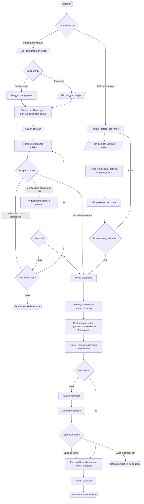
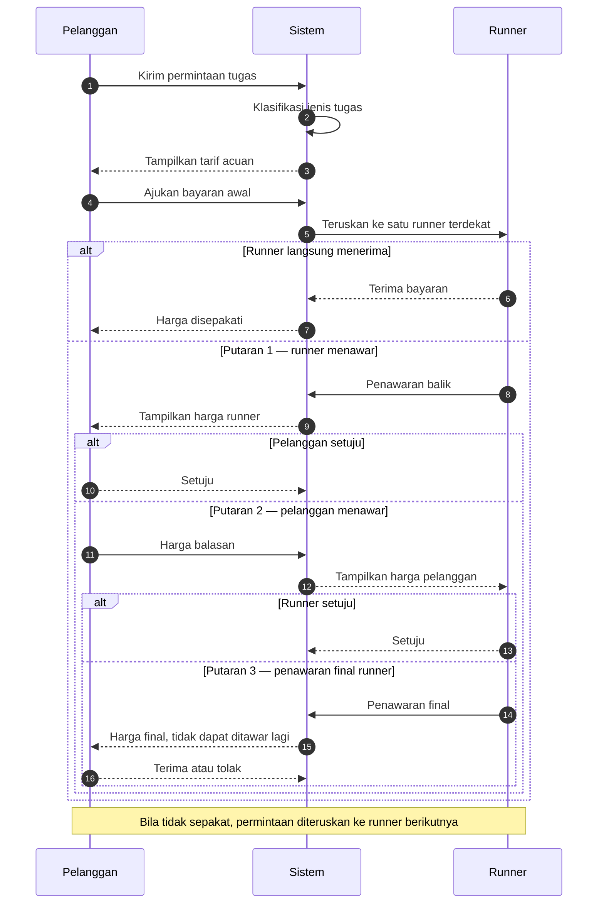
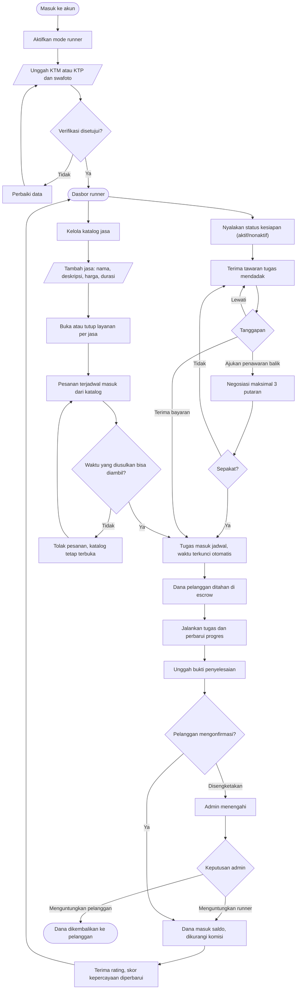

# User Flow

Pembaruan terakhir: 24 Oktober 2026

Notasi mengikuti konvensi flowchart baku: `([...])` terminator, `[...]` proses, `{...}` keputusan, `[/.../]` input dari pengguna.

---

## 1. Alur Pelanggan

---

## 2. Alur Negosiasi — maksimal 3 putaran

Hanya berlaku untuk Jalur A. Pesanan dari katalog memakai harga tetap.

---

## 3. Alur Runner

