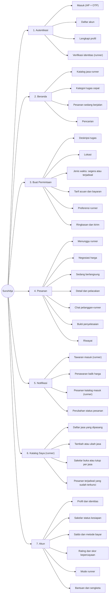

# Information Architecture

Pembaruan terakhir: 24 Oktober 2026

---

## Peta layar

**Navigasi bawah:** Beranda · Pesanan · ➕ Buat Permintaan · Notifikasi · Akun

Menu **Katalog Saya** muncul di dalam Akun, hanya bagi pengguna yang mengaktifkan mode runner, supaya tampilan pelanggan biasa tidak ikut ramai.

---

## Daftar layar untuk prototipe

Peta lengkap di atas berisi sekitar 33 layar. Untuk prototipe *clickable*, 14 layar berikut sudah cukup menunjukkan kedua jalur.

| No | Layar | Sisi | Jalur |
|---|---|---|---|
| 1 | Masuk / Daftar | Keduanya | — |
| 2 | Beranda | Pelanggan | Keduanya |
| 3 | Buat Permintaan | Pelanggan | A |
| 4 | Pilih jenis waktu (segera / terjadwal) | Pelanggan | A |
| 5 | Tarif acuan dan bayaran | Pelanggan | A |
| 6 | Menunggu runner | Pelanggan | A |
| 7 | Penawaran balik masuk | Pelanggan | A |
| 8 | Daftar tawaran | Runner | A |
| 9 | Ajukan penawaran balik | Runner | A |
| 10 | Katalog jasa | Pelanggan | B |
| 11 | Detail jasa dan usulkan waktu | Pelanggan | B |
| 12 | Pesanan berjalan dan pelacakan | Keduanya | Keduanya |
| 13 | Unggah bukti dan konfirmasi | Keduanya | Keduanya |
| 14 | Katalog Saya | Runner | B |

Layar sengketa, riwayat, dan verifikasi identitas cukup ditampilkan sebagai gambar statis di laporan, tidak perlu dibuat *clickable*.
